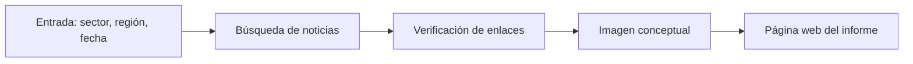
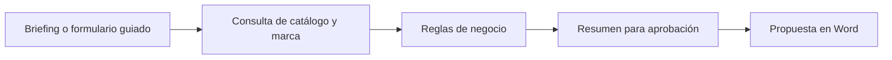
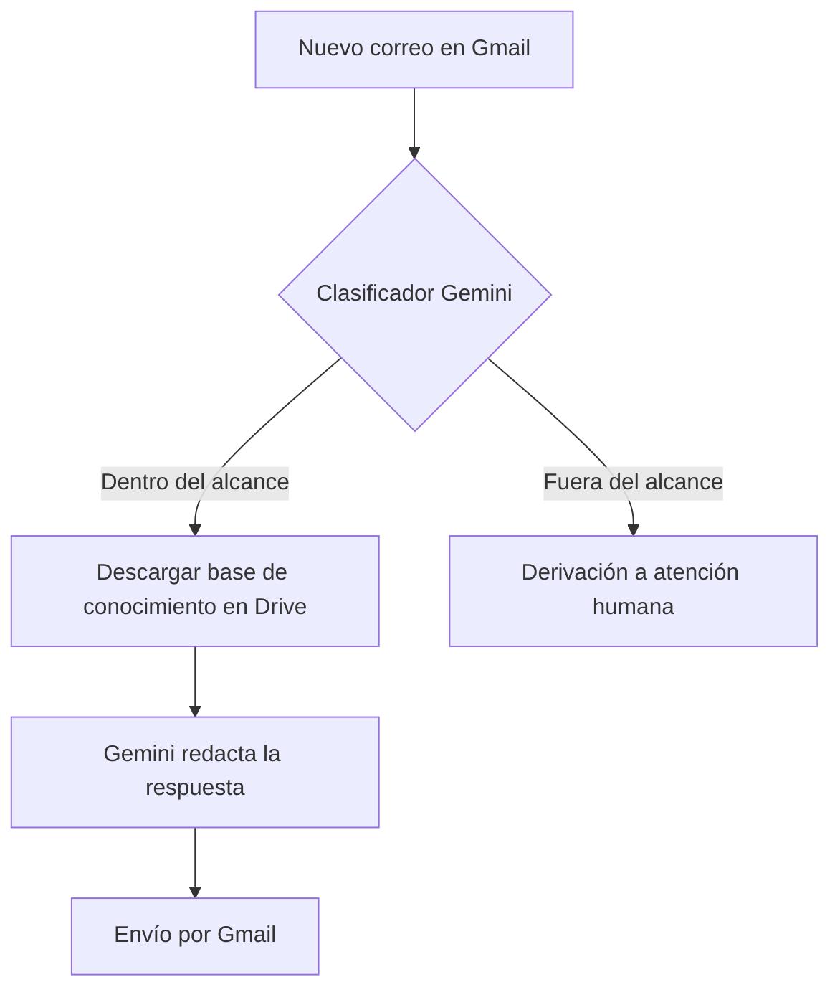
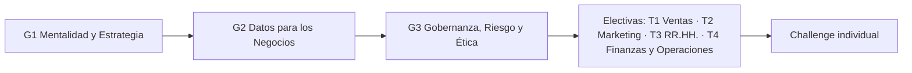

# ONE AI for Business

Portfolio de proyectos desarrollados durante el programa **Oracle Next Education (ONE) & Alura LATAM**.

## Fase 1 · Inmersión

[Agentes de IA para Negocios](https://app.aluracursos.com/immersion/certificate/252a6a08-fb63-46dc-bc4b-1c7a754150d6?lang)

| # | Proyecto | Problema de negocio | Herramientas | Demo |
|---|----------|--------------------|--------------|------|
| 1 | [ARI News](#1-ari-news--inteligencia-de-mercado-con-un-pipeline-de-agentes) | Vigilancia semanal de noticias del sector | Google Opal | [Abrir app](https://opal.google/app/1lLKgqjmZM90UVGhPuxGbYtsn_A3GocnH) |
| 2 | [ARI Deal](#2-ari-deal--propuestas-comerciales-con-reglas-de-negocio) | Propuestas comerciales lentas e inconsistentes | ChatGPT Work | Proyecto privado |
| 3 | [ARI Flow](#3-ari-flow--triaje-y-respuesta-automática-de-correos) | Atención repetitiva de consultas por email | Make · Gmail · Drive · Gemini | [Ver escenario](https://us2.make.com/public/shared-scenario/RcuIxvi6Zzh/ari-flow) |

### 1. ARI News · Inteligencia de mercado con un pipeline de agentes

**Problema.** Mantenerse al día con noticias estratégicas de un sector y una región exige tiempo y suele producir resúmenes inconsistentes o con fuentes dudosas.

**Solución.** Un pipeline visual que recibe sector, región y fecha, busca noticias recientes y entrega una página web de resumen lista para compartir con un equipo.

**Demo.** [Abrir ARI News en Google Opal](https://opal.google/app/1lLKgqjmZM90UVGhPuxGbYtsn_A3GocnH)

> **Disponibilidad:** Google anunció que Opal deja de funcionar el 17 de noviembre de 2026 y que sus flujos pasan a ser skills de Gemini ([FAQ oficial](https://developers.google.com/opal/faq)). Después de esa fecha el enlace dejará de ejecutarse.

**Aprendizajes.** El problema de las **alucinaciones de enlaces** (URLs inventadas) y por qué toda fuente generada por IA debe verificarse antes de usarla.

### 2. ARI Deal · Propuestas comerciales con reglas de negocio

**Problema.** Las propuestas comerciales consumen horas, se desvían del formato de marca y pueden incluir valores incorrectos.

**Solución.** Un agente con proceso, memoria y reglas de negocio que recibe los datos de una oportunidad y prepara una propuesta en Word con precios de catálogo y formato de marca, para revisión humana antes de enviarse.

**Conceptos.** Diferencia entre chatbot, copiloto y agente · contexto persistente · documentos de referencia como memoria del agente · reglas de negocio explícitas · revisión humana antes de generar el documento · conversión del flujo en una skill reutilizable.

**Limitaciones.** Depende de la calidad de los documentos de referencia; toda propuesta requiere revisión antes de salir.

### 3. ARI Flow · Triaje y respuesta automática de correos

**Problema.** Consultas repetitivas que ocupan tiempo de atención y que, en su mayoría, ya están respondidas en la documentación.

**Solución.** Un flujo que monitorea una casilla, clasifica cada correo, responde con apoyo de un documento de conocimiento si está dentro del alcance y deriva el resto a una persona.

**Demo.** [Ver el escenario en Make](https://us2.make.com/public/shared-scenario/RcuIxvi6Zzh/ari-flow)

**Diseño.** La base de conocimiento vive en Drive: quien actualiza el documento actualiza al agente, sin tocar el flujo.

**Riesgos y controles.** Un agente que envía correos sin revisión puede responder o clasificar mal. Controles a considerar: revisión previa, límite de alcance, registro de respuestas, pruebas de clasificación.

## Fase 2 · Business AI Builder

La segunda etapa del programa organiza el aprendizaje en **7 formaciones** y un **challenge individual obligatorio**.

### Programa

| Código | Formación | Tipo | Cursos |
|--------|-----------|------|--------|
| G1 | [Mentalidad y Estrategia](https://app.aluracursos.com/degree/certificate/bc94a872-1d92-4942-bb86-80001f02bab4?lang) | General | 1. [Alfabetización en IA: Competencias esenciales y dominio crítico](https://app.aluracursos.com/certificate/eeddf28a-cc25-401d-80b4-40618f403e1c?lang) 2. Entienda cómo aplicar el Canvas AI en la práctica 3. [IA en el trabajo: Productividad con asistentes y agentes](https://app.aluracursos.com/certificate/202c8bec-3796-4d96-972f-d66c4c927362?lang) |
| G2 | [Datos para los Negocios](https://app.aluracursos.com/degree/certificate/7e164d2f-5a96-4cd0-9850-9c834198bcd1?lang) | General | 1. [Toma de decisiones con IA: Optimizando estrategias con datos](https://app.aluracursos.com/certificate/6002f301-ab4f-41bf-bfda-22149f04a38f?lang) 2. [Liderazgo en la era de la IA: Fundamentos y visión estratégica](https://app.aluracursos.com/certificate/8ec2d4d7-a7a1-4d1a-9d91-9c2b698aee62?lang) 3. [Trabajando con datos: Fundamentos del análisis de datos](https://app.aluracursos.com/certificate/2fa7e0e2-a41c-415f-b5d0-6b8bcc3eb9e8?lang) |
| G3 | Gobernanza, Riesgo y Ética | General | 1. [Gobernanza de Inteligencia Artificial: Fundamentos, riesgos y buenas prácticas](https://app.aluracursos.com/certificate/308830db-18cc-4657-96b9-b039c777b582?lang) 2. Ética en Inteligencia Artificial: Mitigando sesgos y garantizando transparencia |
| T1 | IA para Ventas y Comercial | Electiva | 1. Inteligencia Artificial: Personalice estrategias de ventas con ChatGPT 2. E-mail marketing: Automatización y workflows con IA 3. CRM, automatizaciones e IA: Automatice procesos de ventas con inteligencia artificial |
| T2 | IA para Marketing y Contenido | Electiva | 1. Producción de contenido con IA: Cree asistentes en Gemini para escalar su comunicación multicanal 2. Inteligencia Artificial: Gestión de redes sociales 3. Redes Sociales: Construyendo un agente GPT para su negocio |
| T3 | IA para RR.HH. | Electiva | 1. RR.HH. estratégico: Optimizando procesos con IA 2. Inteligencia Artificial en RRHH: Creando Agentes con ChatGPT 3. People Analytics: De la recolección de datos a la IA aplicada en RR.HH. |
| T4 | IA para Finanzas y Operaciones | Electiva | 1. Análisis financiero eficiente: automatiza Excel con Power Query y Power Pivot 2. Claude para Análisis de Datos: Prompts, integraciones y automatizaciones 3. Gestión de Procesos: Mapeo y automatización con Lean y RPA 4. Make: Automatizando respuestas de clientes |

[Challenge individual](#fase-2--business-ai-builder) | En proceso |

Parte del recorrido [Oracle Next Education (ONE)](https://www.oracle.com/latam/education/oracle-next-education/).
